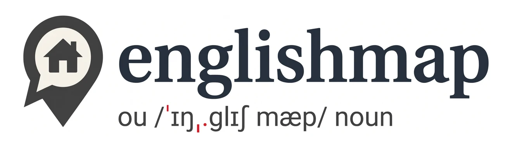

<p align="center">
  
</p>

<p align="center">
  Resources for learning English online as an immersion, by level and cost.<br>
  <a href="https://englishmap.github.io/"><strong>englishmap.github.io</strong></a>
</p>

---

englishmap is a directory of resources for learning English online the way you would by living abroad: what to listen to, watch, read, speak and write in English every day, sorted by CEFR level (A1 to C2) and cost. It is inspired by [NewsMapp](https://github.com/newsmapp/newsmapp.github.io).

The site is available in Brazilian Portuguese (`/`) and English (`/en/`). It is free and non-commercial, with no ads, affiliate links or tracking.

## Features

- 91 resources in 13 categories: setting up your surroundings, listening, watching, TV series, reading, speaking, writing, pronunciation, vocabulary, English for work, tech podcasts (programming, security and AI), guided study and level tests.
- Each resource shows its format, CEFR level range and whether it is free, freemium or paid, so you can decide before clicking.
- Filters by level, cost and text. They are kept in the URL, so you can share a filtered list.
- An immersion guide covering comprehensible input, how to switch your devices and media to English, what to use at each stage, and a sample day with about two hours of English.
- A study abroad page with the four cheapest English-speaking destinations for a language course (the Philippines, Malta, South Africa and Ireland). Entry and work rules for Brazilian passport holders come from official sources.
- Light and dark themes, and no third-party requests at runtime.

## How it works

The catalog lives in [`data/catalog.json`](data/catalog.json) and is validated by a [Zod](https://zod.dev/) schema at build time, so a malformed entry fails the build. [Astro](https://astro.build/) turns it into a fully static site, and GitHub Actions checks, builds and publishes it to GitHub Pages on every push to `main`.

## Getting started

Requirements: Node.js 24 and pnpm 10 (or `mise install`).

```sh
pnpm install
pnpm dev          # http://localhost:4321
pnpm check        # formatting, types, catalog schema and tests
pnpm build        # outputs dist/
```

## Project structure

```
data/catalog.json   Catalog: categories and resources
src/schemas/        Catalog schema
src/lib/            Pure logic: catalog, filters, i18n strings and routes, paths
src/components/     UI components
src/pages/          Routes: / and /en/ (resources), /como-montar/ and /en/guide/ (guide),
                    /intercambio/ and /en/study-abroad/ (study abroad), 404
docs/               Design brief, decisions (ADRs) and brand files (docs/brand/README.md)
```

## Adding a resource

Add an object to `data/catalog.json` with `id`, `name`, `url` (https), `category`, `format` (one of the keys in `src/schemas/catalog.ts`), `summary` with `pt` and `en` texts (up to 200 characters each), `from` and `to` (CEFR levels) and `cost` (`free`, `freemium` or `paid`), then run `pnpm check`.

A resource gets listed if it is useful to someone studying alone at home, it is online, and its level and cost have been checked on its own site. Sponsored entries are not accepted.

## License

- Code: [MIT](LICENSE).
- Content (the catalog, the guide and study abroad texts, and the interface copy): [CC BY 4.0](LICENSE-CONTENT). You can reuse it with credit to englishmap.
- The englishmap logo and symbol are the project's marks and are not covered by either license. Names and logos of the listed resources belong to their owners.
